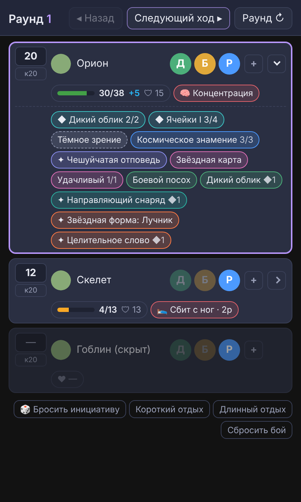
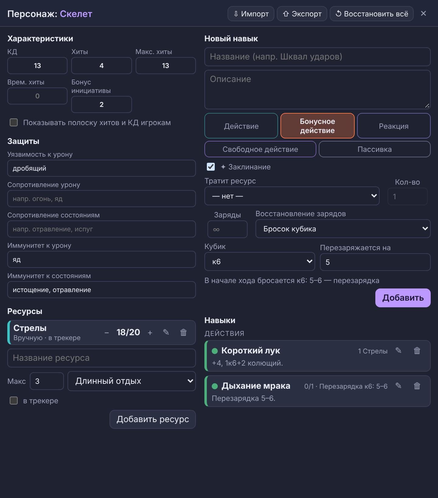
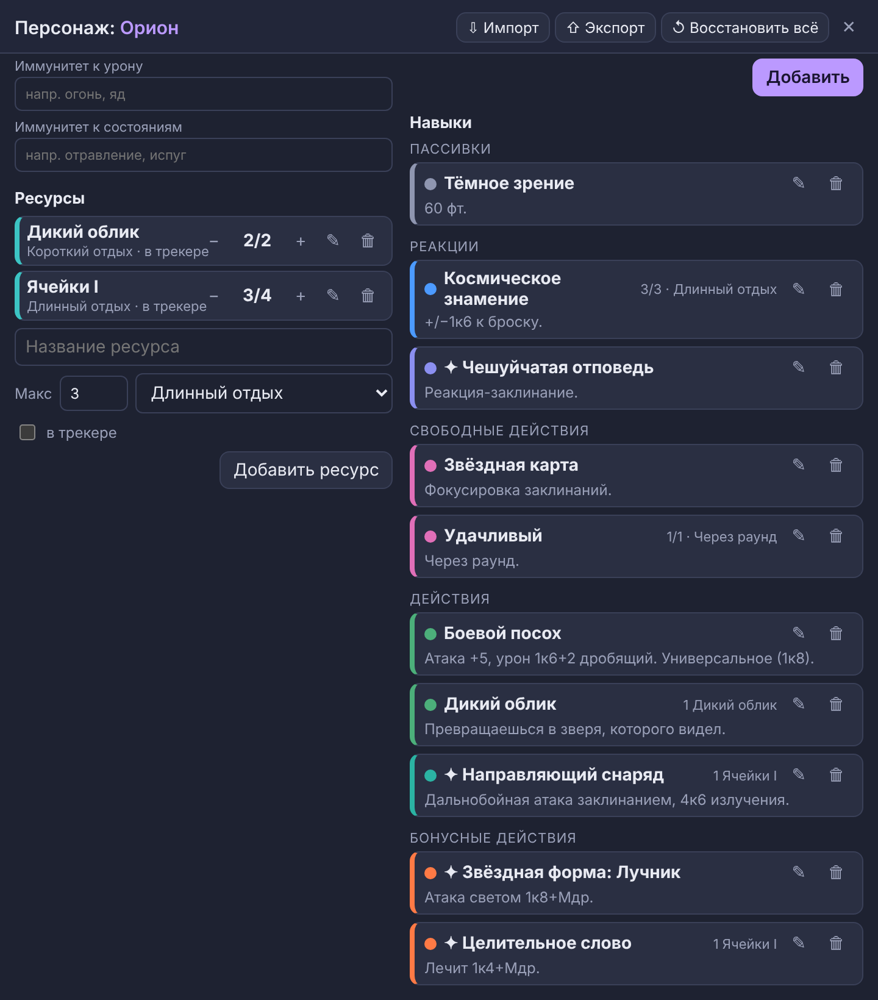

# Initiative & Actions Tracker — трекер инициативы для Owlbear Rodeo

Боевой трекер для D&D 5e: порядок ходов, действие / бонусное действие / реакция,
навыки и заклинания, ресурсы, состояния, хиты и КД — всё в одном окне.
Мастер видит и управляет всем, игроки видят только порядок ходов.

**Адрес для установки в Owlbear Rodeo:**

```
https://stastriada1995-rgb.github.io/obr-initiative/manifest.json
```

Owlbear Rodeo → профиль → **Extensions** → **Add Custom Extension** → вставить адрес → включить расширение в комнате.

<p align="center">
  
</p>

## Возможности

### Трекер
- **Инициатива.** Поле для числа и кнопка «к20» под ним: бросок к20 + бонус инициативы персонажа. Кнопка «Бросить инициативу» внизу бросает за всех, у кого её ещё нет.
- **Д / Б / Р.** Действие, бонусное действие и реакция у каждого участника. Восстанавливаются в начале раунда. Действие и бонусное нажимаются только в свой ход (мастер может обойти через Shift+клик).
- **Шторка навыков.** У того, чей ход, навыки раскрыты, у остальных свёрнуты. Любую шторку можно открыть стрелкой.
- **Порядок в шторке:** защиты → ресурсы → пассивки → реакции → свободные действия → действия и заклинания → бонусные действия.
- **Клик по навыку** сразу тратит всё, что он стоит: кружок Д/Б/Р, ресурс и заряд. Правый клик отменяет. Свободные действия без зарядов отмечаются до конца раунда.
- **Подсказка** при наведении: название, тип и стоимость, описание.
- **Хиты и КД.** Клик по полоске хитов открывает панель «Урон / Лечение / Врем. хиты». Урон сначала снимает временные хиты.
- **Состояния D&D 5e** кнопкой «+», с длительностью в раундах и уровнями истощения.
- **Кнопки «Назад», «Следующий ход», «Раунд»** закреплены вверху. «Назад» откатывает ход вместе со всеми нажатиями.
- **Отдых.** «Короткий отдых» и «Длинный отдых» восстанавливают навыки и ресурсы с соответствующей перезарядкой.

<p align="center">
  
  &nbsp;
  
</p>

### Вид игрока
Игроки видят только номер раунда, порядок ходов, имена с иконками и состояния. Скрытые токены, навыки, хиты и кнопки управления им не показываются. Пункты меню на токене доступны только мастеру.

<p align="center">
  
</p>

### Окно персонажа
Правый клик по токену → **«Навыки персонажа»**.

- **Характеристики:** КД, хиты, макс. хиты, временные хиты, бонус инициативы, галочка «Показывать полоску хитов и КД игрокам».
- **Защиты:** уязвимость к урону, сопротивление урону и состояниям, иммунитет к урону и состояниям.
- **Ресурсы:** Ки, ячейки, стрелы и т.п. — максимум, восстановление, показ в трекере.
- **Навыки:** тип (действие, бонусное, реакция, свободное действие, пассивка), галочка «✦ Заклинание» со своим оттенком цвета, трата ресурса, заряды.
- **Перезарядка:** каждый раунд, через раунд, бросок кубика (например, к6: 5–6 — бросается сам в начале хода существа), короткий отдых, длинный отдых, вручную.
- **Импорт / экспорт** навыков в JSON и кнопка «Восстановить всё» для одного персонажа.

<p align="center">
  
</p>
<p align="center">
  
</p>

### Полоска на токене
Над токеном рисуется полоска хитов (зелёная → жёлтая → красная, временные хиты голубым) и кружок с КД. Мастер видит полоски у всех, игроки — только там, где включена галочка в окне персонажа.

## Цвета навыков

| Тип | Цвет | Заклинание |
| --- | --- | --- |
| Действие | зелёный | бирюзовый |
| Бонусное действие | оранжевый | оранжево-красный |
| Реакция | синий | сине-фиолетовый |
| Свободное действие | розовый | фиолетовый |
| Пассивка | серый, пунктир | — |
| Ресурс | бирюзовый с ◆ | — |

## Публикация и обновление

Сайт собирается и публикуется GitHub Actions при каждом изменении в ветке `main`
(файл `.github/workflows/deploy.yml`). В настройках репозитория должно стоять
**Settings → Pages → Source: GitHub Actions**.

Обновить расширение: загрузить изменённые файлы в репозиторий (**Add file → Upload files**), дождаться зелёной галочки во вкладке **Actions**, перезагрузить комнату в Owlbear.

`manifest.template.json` — заготовка манифеста. Настоящий `manifest.json` с правильными путями создаётся при сборке.

## Магазин расширений Owlbear Rodeo

Страница для магазина лежит в `public/store.md` и публикуется по адресу
`https://stastriada1995-rgb.github.io/obr-initiative/store.md`.
Чтобы попасть в магазин, нужно сделать форк репозитория
[owlbear-rodeo/extensions](https://github.com/owlbear-rodeo/extensions), добавить в конец `extensions.json` строку

```json
"initiative-actions-tracker": "https://stastriada1995-rgb.github.io/obr-initiative/store.md"
```

и отправить pull request в ветку `main` одним коммитом.

## Разработка

```
npm install
npm run dev
```

Адрес для Owlbear при локальной разработке: `http://localhost:5173/obr-initiative/manifest.json`.

| Файл | Что внутри |
| --- | --- |
| `src/main.js` | трекер |
| `src/skills.js` | окно персонажа |
| `src/background.js` | меню на токенах |
| `src/bars.js` | полоска хитов и КД на карте |
| `src/logic.js` | применение навыков, перезарядка, хиты |
| `src/constants.js` | типы навыков, состояния, перезарядка |
| `public/store.md` | страница для магазина Owlbear Rodeo |
