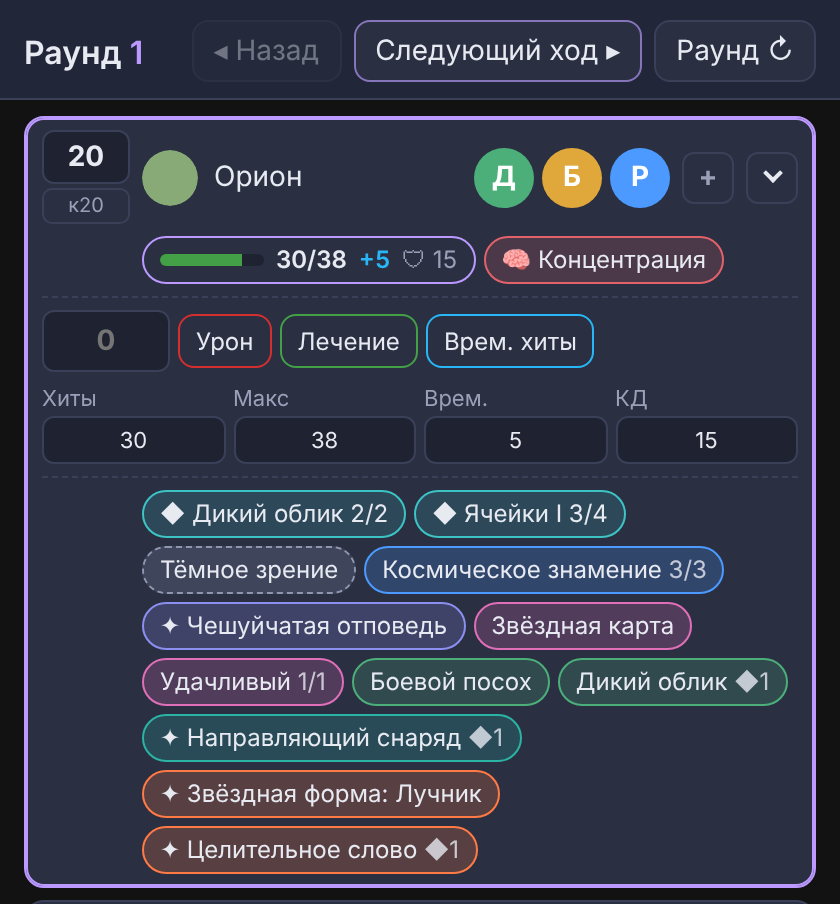
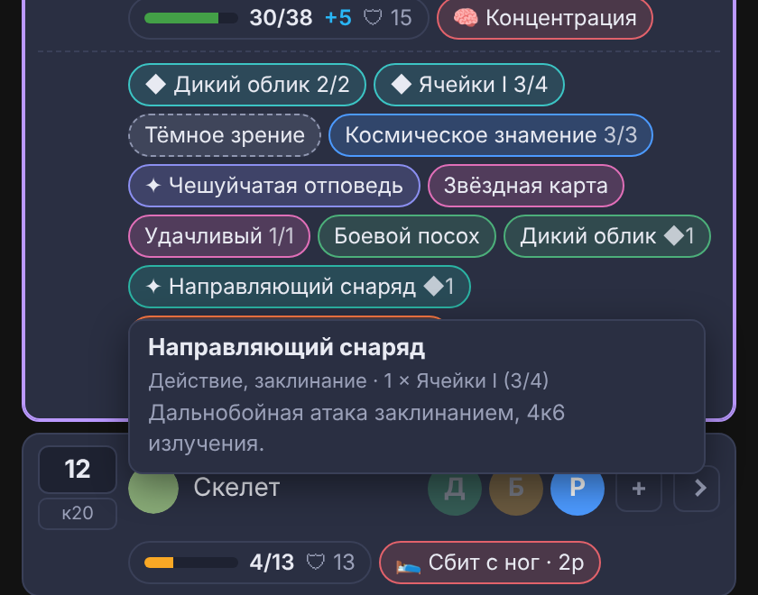
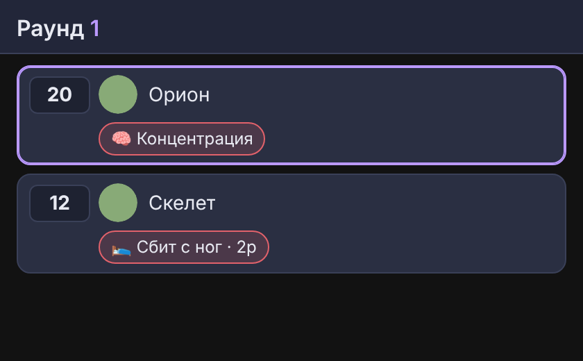

# Initiative & Actions Tracker — an initiative tracker for Owlbear Rodeo.

A combat tracker for D&D 5e: turn order, actions/bonus actions/reactions,
skills and spells, resources, conditions, hit points, and AC — all in one window.
The DM can view and manage everything, while players see only the turn order.

**URL for installation in Owlbear Rodeo:**

```
https://stastriada1995-rgb.github.io/obr-initiative/manifest.json
```

Owlbear Rodeo → profile → **Extensions** → **Add Custom Extension** → paste the URL → enable the extension in the room.

<p align="center">
  
</p>

## Features

### Tracker
- **Initiative.** A numeric field with a "d20" button below it: rolls a d20 + the character's initiative bonus. The "Roll Initiative" button at the bottom rolls for everyone who hasn't rolled yet.
- **A / BA / R.** Action, Bonus Action, and Reaction for each participant. These reset at the start of each round. Action and Bonus Action buttons can only be clicked during a character's own turn (the GM can bypass this by using Shift+click).
- **Skill Panels.** The skills for the character whose turn it is are expanded, while others remain collapsed. Any panel can be expanded manually using the arrow icon.
- **Panel Order:** Defenses → Resources → Passive traits → Reactions → Free actions → Actions and spells → Bonus actions.
- **Clicking a skill** immediately consumes its costs—marking off an Action/Bonus Action/Reaction, a resource, or a charge. Right-clicking reverses this. Free actions without charges are marked as used for the remainder of the round.
- **Hover tooltips:** display the name, type, cost, and description.
- **Hit Points (HP) and Cooldowns:** Clicking the HP bar opens a panel for "Damage / Healing / Temporary HP." Damage is applied to temporary HP first.
- **D&D 5e Conditions:** Can be added via the "+" button, with options for duration (in rounds) and levels of exhaustion.
- **Navigation controls:** "Back," "Next Turn," and "Round" buttons are pinned at the top. The "Back" button reverts the turn, undoing all actions taken during it.
- **Resting:** "Short Rest" and "Long Rest" options restore abilities and resources that have corresponding cooldowns or recharge mechanics.

<p align="center">
  
  &nbsp;
  
</p>

### Player View
Players see only the round number, the turn order, names (along with icons), and statuses. Hidden tokens, skills, hit points, and control buttons are not displayed to them. Menu options on a token are accessible only to the Game Master.

<p align="center">
  
</p>

### Character Window
Right-click on a token → **"Character Abilities"**.

- **Stats:** AC, Hit Points, Max HP, Temporary HP, Initiative Bonus, and a checkbox to "Show HP and AC bars to players."
- **Defenses:** Damage vulnerabilities, resistances (to damage or conditions), and immunities (to damage or conditions).
- **Resources:** Ki points, spell slots, arrows, etc. — includes settings for maximum values, recovery, and visibility in the tracker.
- **Abilities:** Type (Action, Bonus Action, Reaction, Free Action, or Passive); a "✦ Spell" checkbox (with a distinct color tint); resource consumption; and charges.
- **Recharge:** Options include every round, every other round, die roll (e.g., 1d6: 5–6 — automatically rolled at the start of the creature's turn), short rest, long rest, or manual reset.
- **Import/Export:** Ability data can be imported or exported via JSON; a "Restore All" button is also available for individual characters.

<p align="center">
  
</p>
<p align="center">
  
</p>

### Token Bar
Above each token, a health bar is displayed (transitioning from green → yellow → red, with temporary hit points shown in blue), along with a small circle indicating cooldowns. The Game Master can see these bars for all tokens, while players can only see them for tokens where the corresponding option has been enabled in the character window.

## Skill Colors

| Type | Color | Spell |
| --- | --- | --- |
| Action | Green | Turquoise |
| Bonus Action | Orange | Orange-red |
| Reaction | Blue | Blue-violet |
| Free Action | Pink | Violet |
| Passive | Gray, dashed | — |
| Resource | Turquoise with ◆ | — |
